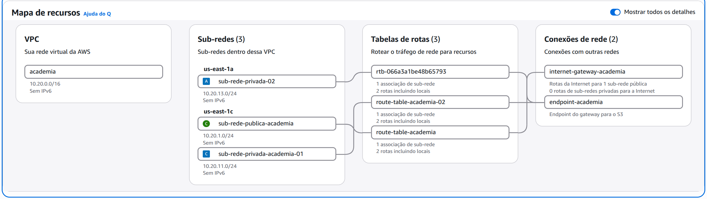
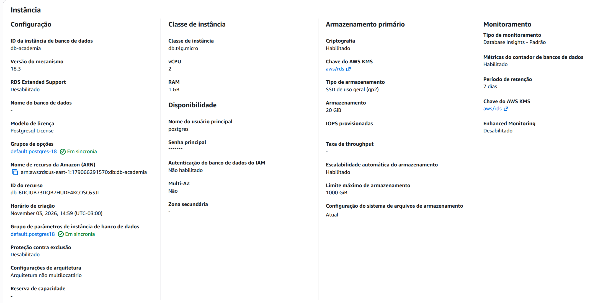
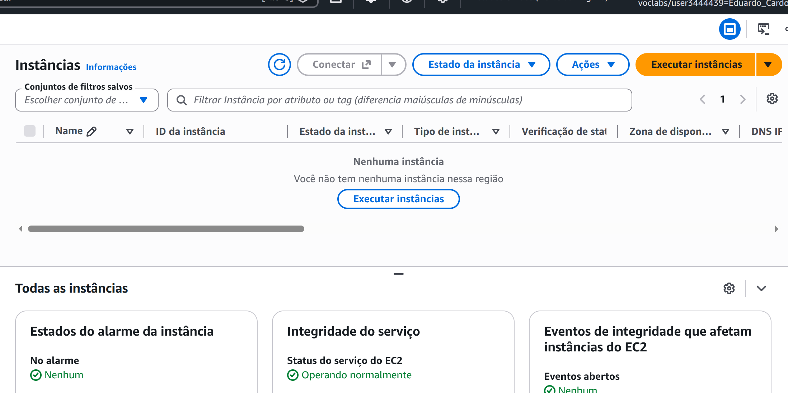
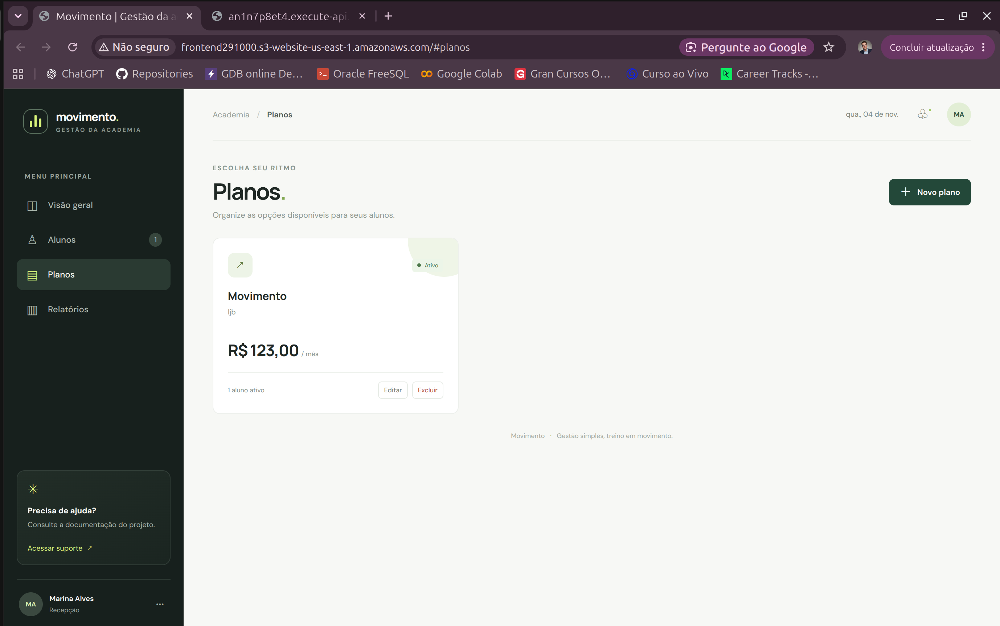
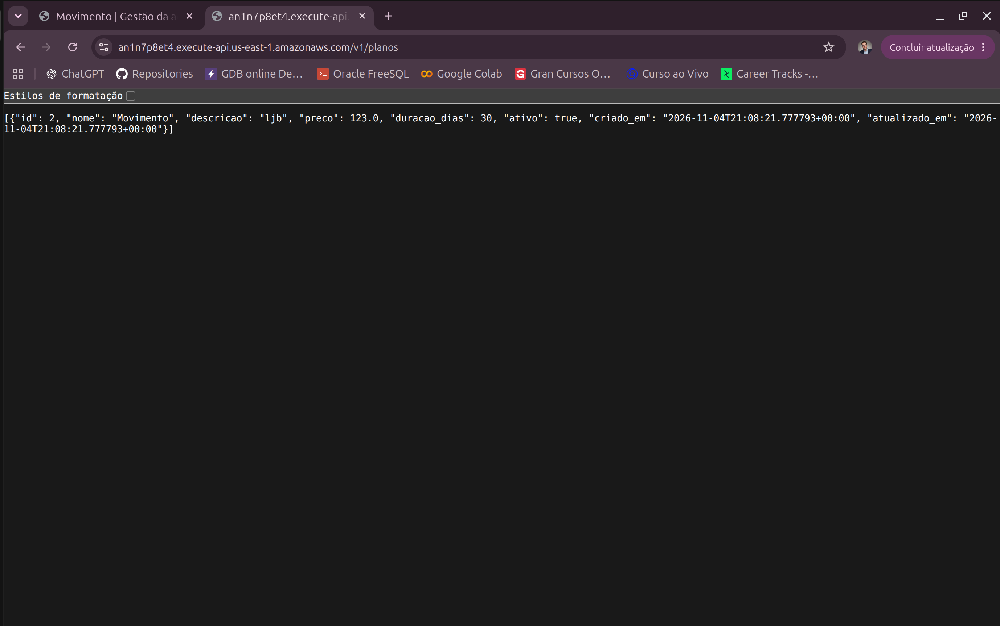
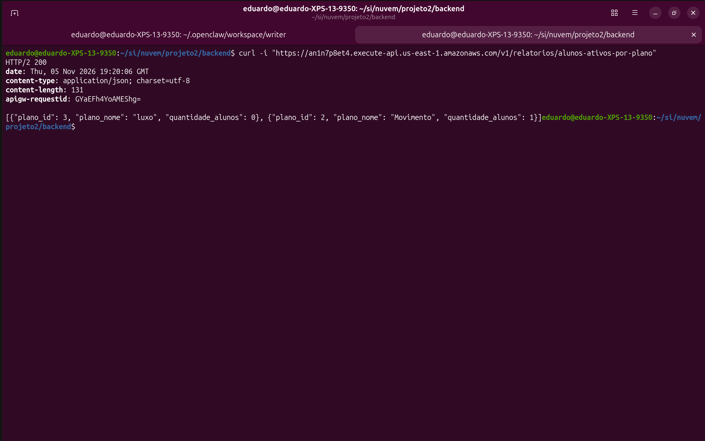

# Evidências da infraestrutura AWS

Atualizado em 05/11/2026 com base nas capturas do Console e nas confirmações do grupo nesta conversa. O agente não acessou a conta AWS. As capturas do mapa da VPC, da configuração do RDS e da lista de instâncias EC2 foram salvas nesta pasta. Os campos marcados como pendentes ainda precisam ser confirmados no Console.

## Região e VPC

| Recurso | Nome / ID | Configuração observada |
|---|---|---|
| Região | us-east-1 | Região dos recursos mostrados |
| VPC | academia / vpc-0c33821ab8e0047e6 | IPv4 CIDR 10.20.0.0/16, sem IPv6 |
| Internet Gateway | internet-gateway-academia | Associado à VPC; ID ainda não registrado |
| Endpoint S3 | endpoint-academia | Tipo Gateway para S3; ID ainda não registrado |

O mapa de recursos mostra que uma subnet pública tem rota para a internet e que nenhuma subnet privada tem rota para a internet. O endpoint S3 aparece conectado às route tables privadas.

## Subnets e route tables

| Tipo | Nome | ID | CIDR | Zona de disponibilidade | Route table |
|---|---|---|---|---|---|
| Pública | sub-rede-publica-academia | subnet-0e8505fff7552e9c5 | 10.20.1.0/24 | us-east-1c | route-table-academia; ID pendente |
| Privada | sub-rede-privada-02 | subnet-02b880fda4885380c | 10.20.13.0/24 | us-east-1a | rtb-066a3a1be48b65793 |
| Privada | sub-rede-privada-academia-01 | subnet-074060106c59757cc | 10.20.11.0/24 | us-east-1c | route-table-academia-02; ID pendente |

As duas subnets privadas estão em AZs diferentes. Cada route table privada mostra duas rotas, incluindo a rota local; a pública mostra a rota local e a saída pelo Internet Gateway. O endpoint Gateway do S3 está associado às route tables privadas.

Uma subnet 10.20.12.0/24, subnet-0313a11f4ac6cafd1, constava no inventário anterior, mas não aparece no mapa mais recente, que mostra três subnets. Confirmar se foi removida ou se o inventário antigo corresponde a uma configuração anterior.

## DB subnet group e RDS

| Campo | Valor |
|---|---|
| DB subnet group | academia-db-subnet-group |
| Subnets associadas | subnet-02b880fda4885380c e subnet-074060106c59757cc |
| Instância RDS | db-academia |
| Engine | PostgreSQL |
| Endpoint | db-academia.cy8d8tcv3q50.us-east-1.rds.amazonaws.com |
| Porta | 5432 |
| Database | academia |
| VPC | academia / vpc-0c33821ab8e0047e6 |
| AZ primária observada | us-east-1c |
| Acesso público | Não |
| Security Group | O grupo informou ter substituído os SGs default pelo sg-rds; registrar ID e conferir no Console |
| Classe da instância | db.t4g.micro (2 vCPU, 1 GiB RAM) |
| Versão do PostgreSQL | 18.3 |
| Armazenamento | SSD gp2, 20 GiB; escalabilidade automática habilitada, máximo de 1000 GiB |
| Criptografia | Habilitada com chave AWS KMS `aws/rds` |
| Multi-AZ | Não |
| Monitoramento | Database Insights padrão; métricas do contador habilitadas; retenção de 7 dias; Enhanced Monitoring desabilitado |

Na captura dos detalhes da instância, o campo inicial “Nome do banco de dados” aparece como `-`. Depois, o grupo criou o database `academia`, aplicou `sql/001_schema.sql` e confirmou com `\dt` que as tabelas `planos` e `alunos` existem. A saída de `\dt` ainda precisa ser salva como evidência no repositório.

## Security Groups e acesso temporário

O grupo informou que criou/configurou sg-lambda-api, sg-lambda-processamento e sg-rds. O desenho esperado permite TCP 5432 no sg-rds somente a partir dos SGs das Lambdas, sem origem pública. Os IDs e as regras finais ainda precisam ser copiados do Console.

Uma regra temporária TCP 5432 com origem em sg-admin-db foi adicionada para aplicar o schema. O grupo confirmou que essa regra foi removida de sg-rds após a aplicação. A EC2 temporária usada para administração era Ubuntu, estava na subnet pública e apresentou o endereço privado 10.20.1.238. A captura da lista EC2 em 05/11/2026 mostra “Nenhuma instância” na região us-east-1, confirmando que não havia instâncias nessa região no momento da captura.

## Lambda CRUD e HTTP API

| Recurso | Valor / estado informado |
|---|---|
| Lambda | `academia-crud`, runtime Python 3.14 (observado nos logs), associada à VPC privada |
| Security Group da Lambda | `lambda-api`, `sg-0a322afe4af34901e` (captura do Console) |
| HTTP API | Implantada; invoke URL `https://an1n7p8et4.execute-api.us-east-1.amazonaws.com` |
| URL base usada pelo front-end | `https://an1n7p8et4.execute-api.us-east-1.amazonaws.com/v1` |
| Estado | O grupo confirmou resposta da API após corrigir incompatibilidade entre `pg8000` e `scramp`; o fluxo CRUD ainda precisa de validação e evidências |

O handler da Lambda separada `academia-relatorio` está em `backend/report_lambda.py`; o pacote é gerado com `bash backend/package_report.sh`. Em 05/11/2026, o grupo confirmou a implantação da Lambda e da rota `GET /v1/relatorios/alunos-ativos-por-plano` no API Gateway. Uma chamada direta com `curl` retornou HTTP/2 200 e dois planos: `luxo` com zero alunos ativos e `Movimento` com um. A captura está salva como `evidencia-api-relatorio-rf04.png`; a validação dos cenários restantes e da tela ainda está pendente. O agente não acessou a conta AWS.

O pacote atual fixa `pg8000==1.31.6` e `scramp==1.5.0`. Credenciais do RDS permanecem somente na configuração da Lambda e não devem ser registradas neste inventário.

## Site estático no S3 e CORS

| Recurso | Valor / estado informado |
|---|---|
| Bucket do site | `frontend291000` (nome visível na captura compartilhada) |
| Site | Publicado no S3 segundo confirmação do grupo |
| URL pública observada | `http://frontend291000.s3-website-us-east-1.amazonaws.com/` |
| API usada pelo front-end | `https://an1n7p8et4.execute-api.us-east-1.amazonaws.com/v1` |
| CORS da HTTP API | Configurado para o site; o grupo confirmou que a correção resolveu `Failed to fetch` |

A tela inicial de CORS mostrava uma URL de objeto S3. A origem final deve corresponder à origem do site publicado, sem caminho `/index.html`; o grupo confirmou que a correção permitiu a chamada da API pelo navegador. A captura da configuração final de CORS ainda precisa ser salva.

## Estado das tarefas AWS

- Concluído visualmente: VPC, subnets em duas AZs, associação das route tables, Internet Gateway e endpoint Gateway do S3.
- Concluído segundo confirmação do grupo: DB subnet group, RDS privado, criação do database academia, aplicação do schema inicial e conferência de planos e alunos com \dt.
- Concluído segundo confirmação do grupo: criação e correção da associação dos Security Groups.
- Pendente: registrar a saída de `\dt` e os IDs/regras finais dos SGs.
- Concluído segundo confirmação do grupo: publicação da Lambda CRUD e da HTTP API; resposta observada após atualização das dependências.
- Concluído segundo confirmação do grupo: publicação do site no S3 e correção do CORS da API para permitir a integração pelo navegador.
- Concluído segundo confirmação do grupo: implantação da Lambda de relatório RF-04 e da rota `GET /v1/relatorios/alunos-ativos-por-plano`; chamada direta retorna HTTP 200 e a evidência foi salva. Faltam os demais cenários de teste e a validação da tela.
- Pendente: executar o roteiro CRUD em docs/evidencias/roteiro-integracao-rf01.md, salvar evidências, registrar a URL final do site e implementar o fluxo de documentos.

## Capturas salvas

### Mapa da VPC

A captura mostra a VPC `academia` (`10.20.0.0/16`), as três subnets em `us-east-1a` e `us-east-1c`, as três tabelas de rotas, o Internet Gateway e o endpoint Gateway do S3.

### Configuração da instância RDS

A captura mostra a instância `db-academia`, PostgreSQL 18.3, classe `db.t4g.micro`, armazenamento gp2 de 20 GiB com criptografia habilitada, sem Multi-AZ e com monitoramento padrão. A senha aparece mascarada na captura.

### EC2 temporária encerrada

A captura da página de instâncias EC2 mostra que não havia nenhuma instância na região selecionada no momento da verificação (05/11/2026).

### Integração do site com a API — planos

A captura do site mostra o plano ativo `Movimento`, seu preço e a quantidade de alunos associados.

A chamada direta `GET /v1/planos` retorna o mesmo registro em JSON. As duas capturas comprovam a leitura de planos pela API e sua apresentação na interface.

### Relatório RF-04

A chamada direta com `curl` ao endpoint do relatório retornou HTTP/2 200 e JSON com dois planos ativos: `luxo`, com zero alunos ativos, e `Movimento`, com um aluno ativo.

### Alunos

O grupo também compartilhou capturas da tela de alunos no site e da resposta direta de `GET /v1/alunos`. Elas mostram o mesmo registro e confirmam a leitura integrada, mas foram mantidas fora do repositório público porque exibem dados pessoais. Gere novas capturas com dados fictícios antes de adicioná-las. Isso ainda não comprova os testes completos de criação, edição e exclusão do roteiro RF-01.
