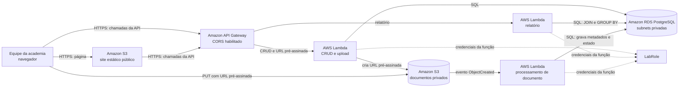
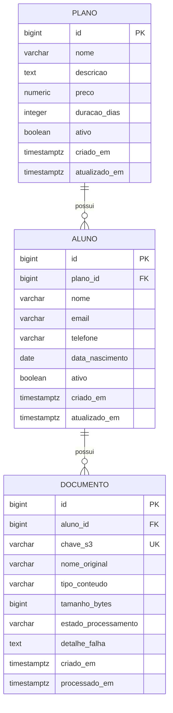

# Design — Sistema de Gestão de Academia

> Este documento descreve a arquitetura planejada para atender à especificação em `specs/spec.md`. Os recursos AWS ainda precisam ser criados e configurados conforme o README do projeto.

## 1. Arquitetura proposta

### Diagrama

### Componentes e responsabilidades

- **Front-end:** página estática publicada no Amazon S3. É servida ao navegador e faz chamadas HTTPS à API.
- **API Gateway:** ponto de entrada HTTPS da API, com CORS configurado para a origem do front-end. Encaminha operações de cadastro e upload para a Lambda de CRUD e o relatório para sua Lambda.
- **Lambda de CRUD e upload:** valida as requisições, acessa os dados de alunos, planos e documentos no RDS e gera URLs pré-assinadas para upload e download.
- **Lambda de relatório:** executa a consulta agregada de alunos ativos por plano.
- **Amazon RDS for PostgreSQL:** banco relacional em subnets privadas, sem acesso público.
- **Bucket S3 de documentos:** bucket privado, separado do bucket que publica o site. Recebe arquivos por URLs pré-assinadas e emite eventos de criação de objeto.
- **Lambda de processamento:** recebe eventos do bucket de documentos, valida a referência ao documento e registra no RDS metadados técnicos e o estado do processamento.
- **LabRole:** role disponibilizada pelo Learner Lab para execução das Lambdas. As permissões necessárias devem ser configuradas na role fornecida; não será criada uma role IAM própria.

### Fluxo de envio e processamento de documento

1. A equipe seleciona um aluno e um arquivo na interface.
2. A interface solicita à API uma URL de envio. A Lambda valida o aluno e o tipo e tamanho informados, cria um registro de documento com estado `pendente` e uma chave de objeto única, e devolve uma URL pré-assinada de curta duração.
3. O navegador envia o arquivo diretamente ao bucket privado usando HTTPS e a URL recebida. A URL deve ser usada apenas para o objeto e a operação autorizados.
4. O evento `ObjectCreated` do S3 aciona a Lambda de processamento.
5. A Lambda localiza o registro pelo identificador presente na chave do objeto, confere os metadados do S3 e atualiza tamanho, tipo, data de processamento e estado no RDS.
6. A interface consulta o cadastro do documento e apresenta `concluído` ou `com falha`. O processamento deve ser idempotente, pois eventos do S3 podem ser entregues mais de uma vez.

O backend deve registrar o documento antes de devolver a URL. Assim, o evento S3 consegue associar o objeto ao aluno sem confiar em um identificador enviado livremente pelo navegador. O nome físico do objeto deve ser gerado pelo backend, por exemplo `alunos/{aluno_id}/documentos/{documento_id}`; o nome original enviado pelo usuário fica apenas como metadado no RDS.

## 2. Modelo de dados

### Diagrama ER

### Entidades e regras de integridade

- **PLANO:** opção comercial oferecida pela academia. `preco` deve ser maior que zero e `duracao_dias` maior que zero.
- **ALUNO:** pessoa cadastrada pela equipe. Cada aluno referencia exatamente um plano existente por `plano_id`. O e-mail deve ser validado e único, conforme validação final acordada pelo grupo.
- **DOCUMENTO:** arquivo associado a um aluno e armazenado no bucket privado. `chave_s3` é única. `estado_processamento` aceita `pendente`, `concluido` ou `falha`.
- A chave estrangeira `ALUNO.plano_id` impede apagar um plano ainda referenciado. A chave estrangeira `DOCUMENTO.aluno_id` impede excluir um aluno com documentos sem que a política de retenção e remoção tenha sido definida.
- Para manter histórico e integridade, recomenda-se inativar planos e alunos em vez de apagá-los quando já tiverem relações. Se a interface oferecer exclusão física, a API deve respeitar as restrições das chaves estrangeiras e explicar por que a exclusão não foi permitida.

## 3. Rotas da API

Todas as rotas usam HTTPS pelo API Gateway e retornam JSON, exceto o envio direto do conteúdo do arquivo ao S3. O prefixo de versão (`/v1`) é proposto para permitir evolução futura. Os métodos e nomes abaixo são o contrato planejado; o formato final dos payloads será detalhado durante a implementação.

| Método e rota | Responsabilidade | Execução |
|---|---|---|
| `GET /v1/planos` | Listar planos, com opção de filtrar ativos. | Lambda de CRUD |
| `POST /v1/planos` | Criar um plano. | Lambda de CRUD |
| `GET /v1/planos/{planoId}` | Consultar um plano. | Lambda de CRUD |
| `PUT /v1/planos/{planoId}` | Atualizar um plano. | Lambda de CRUD |
| `DELETE /v1/planos/{planoId}` | Remover um plano se não houver alunos relacionados; caso contrário, retornar conflito. | Lambda de CRUD |
| `GET /v1/alunos` | Listar alunos, com filtros opcionais por plano e estado. | Lambda de CRUD |
| `POST /v1/alunos` | Criar aluno associado a um plano ativo. | Lambda de CRUD |
| `GET /v1/alunos/{alunoId}` | Consultar aluno e seu plano. | Lambda de CRUD |
| `PUT /v1/alunos/{alunoId}` | Atualizar dados ou plano do aluno. | Lambda de CRUD |
| `DELETE /v1/alunos/{alunoId}` | Remover aluno quando permitido pelas regras de integridade e retenção. | Lambda de CRUD |
| `GET /v1/alunos/{alunoId}/documentos` | Listar metadados e estado dos documentos do aluno. | Lambda de CRUD |
| `POST /v1/alunos/{alunoId}/documentos/upload-url` | Validar solicitação, criar documento pendente e devolver URL pré-assinada de `PUT`, chave e prazo de expiração. | Lambda de CRUD |
| `POST /v1/documentos/{documentoId}/download-url` | Devolver URL pré-assinada de curta duração para baixar o documento, após validar que ele existe. | Lambda de CRUD |
| `GET /v1/relatorios/alunos-ativos-por-plano` | Retornar cada plano ativo e a quantidade de alunos ativos associados. | Lambda de relatório |

### Convenções de resposta e erro

- `200 OK` para consultas e atualizações concluídas; `201 Created` para criação; `204 No Content` para remoção concluída.
- `400 Bad Request` para dados inválidos, incluindo tipo ou tamanho de arquivo não permitido.
- `404 Not Found` quando plano, aluno ou documento não existir.
- `409 Conflict` quando uma remoção violar uma relação existente ou outra regra de integridade.
- `500` para erro inesperado, sem expor credenciais, detalhes de conexão ou informação sensível do banco.
- Respostas de erro devem conter uma mensagem útil para a interface e um identificador de requisição para facilitar a investigação nos logs do CloudWatch.

## 4. Segurança de rede e CORS

### VPC e Security Groups

O RDS fica em subnets privadas e com acesso público desabilitado. As Lambdas que acessam o banco ficam conectadas à VPC, em subnets privadas. A API Gateway é o ponto público HTTPS; não se abre o RDS para a internet.

| Security Group | Regras de entrada | Regras de saída |
|---|---|---|
| `sg-lambda-api` | Nenhuma entrada iniciada pela internet. Invocações do API Gateway são gerenciadas pela integração Lambda, fora das regras de entrada deste SG. | TCP `5432` para `sg-rds`; HTTPS `443` para o S3 por meio do VPC Gateway Endpoint, conforme a política e as rotas da VPC. |
| `sg-lambda-processamento` | Nenhuma entrada iniciada pela internet. A invocação ocorre pelo evento do S3 via integração de serviço. | TCP `5432` para `sg-rds`; HTTPS `443` para o S3 por meio do VPC Gateway Endpoint, se a função precisar consultar metadados do objeto. |
| `sg-rds` | TCP `5432` somente a partir de `sg-lambda-api` e `sg-lambda-processamento`. | Saída padrão necessária às respostas de conexões iniciadas pelas Lambdas; não permitir entrada pública. |

Security Groups são stateful. As Lambdas não recebem IP público. Como Lambdas na VPC não têm internet por padrão no Learner Lab, o VPC Gateway Endpoint para S3 deve estar associado às route tables das subnets privadas. Não manter NAT Gateway ativo para este fluxo. API Gateway não precisa de regra de entrada no SG do banco.

### CORS

- **API Gateway:** permitir como origem apenas o domínio publicado do front-end; permitir os métodos HTTP utilizados pela API e os cabeçalhos `Content-Type` e `Authorization` caso autenticação seja adicionada futuramente. Responder às requisições `OPTIONS` de preflight.
- **Bucket privado de documentos:** permitir `PUT` do domínio do front-end, os cabeçalhos necessários ao upload e expor cabeçalhos de resposta exigidos pelo navegador. Configurar `GET` apenas se o download direto via URL pré-assinada for usado.
- O bucket de documentos permanece privado. O bucket do site é separado e contém somente arquivos estáticos públicos do protótipo/aplicação.

### Credenciais e permissões

- Usar somente a `LabRole` fornecida para Lambdas, com as permissões mínimas necessárias para logs, acesso ao S3 e acesso à configuração de conexão do RDS.
- Não armazenar senhas, chaves ou tokens no repositório, no front-end ou no código-fonte.
- A URL pré-assinada é temporária e deve expirar em poucos minutos. O navegador recebe permissão apenas para a operação e o objeto específicos.
- Nunca publicar o bucket de documentos. Restringir a origem e as operações de CORS ao necessário para o front-end.

## 5. ADR-001 — Execução do CRUD em Lambda

**Status:** Proposta

### Contexto

O projeto precisa oferecer CRUD para alunos e planos, upload de arquivos via URL pré-assinada e relatório em Lambda. O ambiente é o AWS Learner Lab, que fornece `LabRole` para Lambdas e `LabInstanceProfile` para EC2, tem orçamento limitado e exige recriação operacional após expiração da sessão. O RDS deve ser privado.

### Decisão

Executar as rotas de CRUD e emissão de URLs pré-assinadas em AWS Lambda dentro da VPC, conectadas ao RDS privado. O relatório e o processamento de eventos S3 também serão Lambdas. O front-end será estático no S3 e a API será exposta pelo API Gateway.

### Justificativa

- Evita manter uma instância EC2 ligada para servir a API, reduzindo custo e passos de recuperação de ambiente.
- Usa o mesmo modelo de execução serverless já exigido para o relatório e o evento S3.
- API Gateway e Lambda fornecem um endpoint HTTPS sem depender de IP público fixo da EC2.
- As funções podem acessar o RDS privado por Security Groups, e o acesso ao S3 a partir da VPC pode usar o VPC Gateway Endpoint gratuito.

### Consequências e cuidados

- Lambdas em VPC não têm acesso geral à internet. As funções não devem depender de serviços externos durante a execução; o tráfego ao S3 deve usar o endpoint da VPC.
- Abrir e fechar conexões ao RDS a cada invocação pode consumir conexões do banco. Usar instância pequena e baixo volume esperado, definir timeouts curtos, limitar concorrência conforme necessário e reutilizar conexões com cuidado. Confirmar a capacidade da instância escolhida no Learner Lab.
- Todas as Lambdas que acessam o banco precisam usar os Security Groups previstos e receber configuração de conexão sem credenciais versionadas no repositório.
- Aumentar a concorrência sem controle pode esgotar conexões disponíveis no RDS; monitorar logs e erros no CloudWatch durante as demonstrações.
- Se o limite de conexões ou a latência se tornar um problema, o grupo deve rever esta decisão e registrar um novo ADR antes de alterar a arquitetura.

## 6. Decisões pendentes antes da implementação

- Confirmar no Learner Lab a engine e a classe do RDS disponíveis; este design propõe PostgreSQL e porta `5432`.
- Definir o limite máximo de tamanho dos documentos e o prazo exato de expiração das URLs pré-assinadas.
- Definir como serão obtidas as credenciais de banco sem colocá-las no repositório e quais permissões já existem na `LabRole`.
- Confirmar se a exclusão de aluno será física ou se a interface oferecerá apenas inativação quando houver documentos associados.
- Registrar no README a sequência de criação manual dos recursos, configuração das subnets, Security Groups, endpoint S3, CORS, Lambdas, API Gateway e publicação do front-end.

